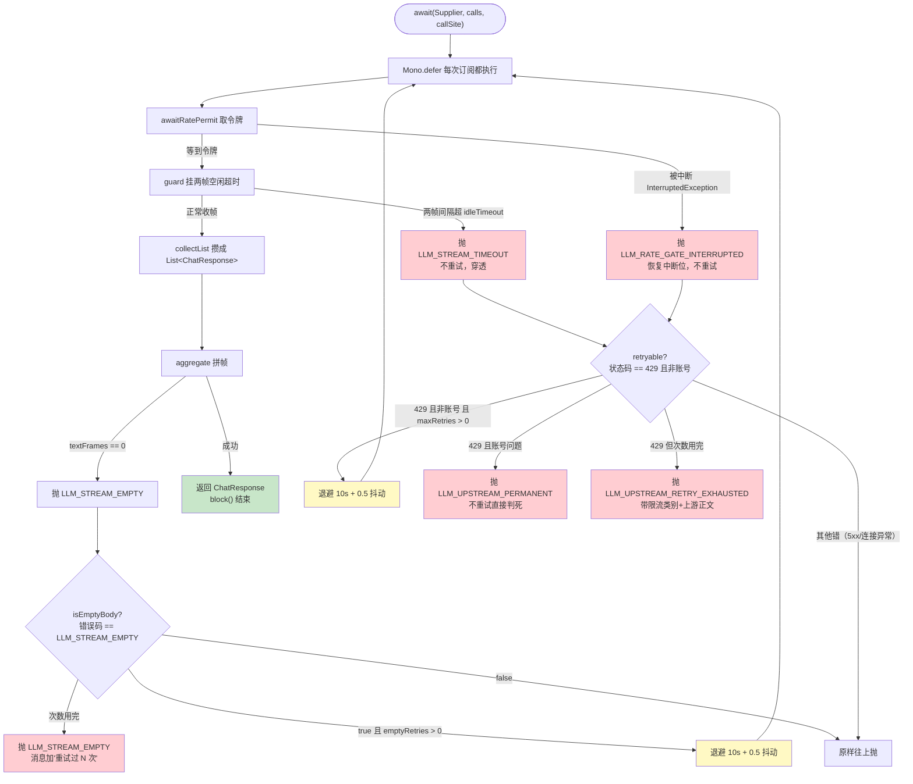

# LlmStreams



## `Flux<ChatResponse>`：

OpenAI 兼容的流式响应（SSE）-- 上游不等整段回答生成完，每吐几个 token 就发一个 HTTP chunk。
Spring AI 把每个 chunk 包成一个 ChatResponse，
一串就成了 Flux<ChatResponse>。.collectList() 就是 "等它推完，把所有帧攒成List给我"。

## 为什么非要流式：

非流式调用 call() 的语义是 "请求发出后阻塞到完整响应返回" 。对模型来说一轮完整的输出常达 30~80 秒，而底层
HTTP 客户端在 10 秒没有新字节时直接判定读超时

流式把超时语义从 "整段生成总时长" 换成 "两帧之间的间隔"：只要服务端还在持续推字节，读超时计时器就不断重置。慢但正常的长回答不会被误杀，
同时首字延迟从 "50 秒后" 降到 "1~2 秒后"，对交互式 Agent 体验是决定性的。
代价是响应被切碎：下游拿到的是 500 个独立帧，正文要自己拼、usage 要自己聚合、
`finishReason` / `model` 要从最后一帧提取 —— 这正是 `LlmStreams.aggregate` 存在的原因。

## Spring AI 的 advisor 链是一次性的：

chatClient.prompt(prompt).stream()，这一行并不会立即发 HTTP 请求，而是构造一个 `DefaultStreamResponseSpec`，
内部持有 `DefaultAroundAdvisorChain` -- 本质是一个 `Deque<StreamAdvisor>`（记日志，塞 conversationId，安全护栏等排成队列）
每次下游订阅这个流时，链通过 `nextStream` 逐个 pop() 取出 advisor，把请求层层包裹，最后一个 advisor 才真正发起 HTTP 调用

问题在于这个 `Deque` 是一次性的：`pop()` 一次少一个，订阅完成后队列已空。
如果下游把同一个 `Flux<ChatResponse>` 二次订阅（例如重试时直接对同一条流再 `.block()` 一次），
所有 advisor 都已出队，链抛 `IllegalStateException("No StreamAdvisors available to execute")` -- 第二次
连 HTTP 请求都不会发。

**这会造成什么问题**

假设你想给 LLM 调用加重试，直觉写法是

```java
Flux<ChatResponse> stream=chatClient.prompt(prompt).stream().chatResponse();

//第一次尝试
ChatResponse r1=stream.timeout(...).collectList().block();

//如果失败了
ChatResponse r2=stream.timeout(...).collectList().block();
```

预期是第一次收到 429，等 10 秒，第二次重新发送请求，成功

实际上：

第一次 block() 正常 -- advisor 链逐个 pop，发 HTTP 请求，收到 429

你捕获到 429，等 10 秒，第二次 `block()`——直接抛 `IllegalStateException: No StreamAdvisors available to execute`。

因为 advisor 链内部是个 Deque，每处理一个 advisor 就 pop() 一个。第一次订阅完，队列已经空，
第二次订阅时没有 advisor 可用，Spring AI 直接抛错，连 HTTP 请求都没有发出去

这个错误造成的后果：

1.重试根本没有生效

2.原始错误被盖掉了

3.白等退避时间

**代码里怎么修的**

`public static ChatResponse await(Supplier<Flux<ChatResponse>> stream, ...)`

调用方传进来的是 

`() -> chatClient.prompt(prompt).stream().chatResponse()`

每次重试时，重新调一次这个 lambda -- 也就是重新执行 prompt().stream()，重新建一条 advisor 链，重新发 
HTTP 请求。旧的流直接扔掉，根本不重订阅

```java
Mono<ChatResponse> attempt=Mono.defer(() -> {
    return guard(stream.get(), idleTimeout, ...)
            .collectList()
            .map(frames -> aggregate(frames, callSite));
});
```

Mono.defer 在这里的作用是：里面的 lambda 不是现在执行，而是每次有人订阅时才执行。
重试=重新订阅=重新执行lambda=重新造一条流

## aggregate

把流式返回的 N 个碎片帧，拼成一个跟非流式调用形状完全一样的 `ChatResponse`

1.拼正文：遍历所有帧，把每帧带的半句话 append 起来，得到完整回答

2.聚 usage：从最后一个真正带 token 计数的帧取出 prompt/completion tokens，用于成本统计

3.判失败：如果一帧正文都没有，抛 `LLM_STREAM_EMPTY`（外层会接住这个错做空正文重试）

三类累加器

```java
StringBuilder text = new StringBuilder();   // 拼正文
String model = null;                         // 模型名，取最后一个非空
String lastFinishReason = null;              // 结束原因，取最后一个非空
Integer promptTokens = null;                 // 总 prompt token
Integer completionTokens = null;             // 总 completion token
int textFrames = 0;                          // 有正文的帧数
int noChoiceFrames = 0;                      // 没有 choices 的帧
int blankTextFrames = 0;                    // 有 choices 但正文空的帧
```

1.末帧是空壳，getResult() 返回 null 不是异常

OpenAI 兼容协议的最后一帧经常长这样：

`{"choices": [], "usage": {"prompt_tokens": 100, "completion_tokens": 800}}`

它没有任何正文，只有 token 计数。这时 `frame.getResult()` 返回的是 **null**（不是抛异常），因为 `choices` 是空数组，Spring AI 找不到一个 `Generation`。

2.每帧的 usage 是该帧自己的，不是累积值

Spring AI 1.0 在顶层调用时 `previousChatResponse` 是 null，它的累积逻辑直接返回当前帧的值 —— 也就是说每帧的 usage 只是这一小段 chunk 自己的 token 数。

3.空帧要分为两类，因为原因和处置不同

| 计数器 | 含义 | 占多数时说明什么 | 处置 |
| ---- | ---- | ---- | ---- |
| textFrames | 有正文的帧 | 正常 | 拼起来 |
| noChoiceFrames | 帧里没有 choices（心跳、空壳末帧） | 端点没按流式下发正文 | 调 max-tokens 没用 |
| blankTextFrames | 有 choices 但 content 是空串 | 推理模型把内容写进了 reasoning_content，思考把预算吃光了 | 该调大 max_tokens |

`blankTextFrames` 多 → 模型把整轮输出写进了思考通道，Spring AI 1.0 的 POJO 没认识 `reasoning_content` 这个字段，思考把 `max-tokens` 预算吃光了，正式回答一个字没剩 → 该抬 max-tokens

## 重试

```java
// 内层 429 重试。<T> 泛型因为这层逻辑跟元素类型无关
private static <T> Mono<T> retrying(Mono<T> attempt, int maxRetries,
                                    Duration backoff, String callSite) {
    // 次数<=0 时整条不挂。传 Retry.backoff(0) 会在第一个错误就触发耗尽发生器，把 429 换成"重试已耗尽"
    if (maxRetries <= 0) {
        return attempt;
    }
    // 退避时间：null 或负值钳成 ZERO。Retry.backoff 不收负 Duration
    Duration delay = backoff == null || backoff.isNegative() ? Duration.ZERO : backoff;
    // 原子计数器，只用于日志显示第几次重试
    AtomicInteger retriesSoFar = new AtomicInteger();

    // 给 attempt 挂重试
    return attempt.retryWhen(Retry.backoff(maxRetries, delay)
            // 白名单：返回 true 才重试。只有 429 且非账号问题才进这层
            // 中断/超时/5xx/连接异常都返回 false，原样往下抛
            .filter(LlmStreams::retryable)
            // 每次重试前打 WARN：状态码、第几次、退避多久、限流类别、上游正文
            // 0.5 抖动是 Reactor 默认，向上取，delay 是下限不是均值
            // 抖动是承重的——两拨调用方同时撞上来时，固定退避会让它们同一毫秒再撞
            .doBeforeRetry(signal -> log.warn(
                    "[llm-stream] 上游 {} 限流，退避后重试 | callSite={} | 第 {}/{} 次重试"
                            + " | 基础退避={}ms（带 0.5 抖动，实际更长） | 限流类别={} | 上游正文={}",
                    statusOf(signal.failure()), callSite, retriesSoFar.incrementAndGet(),
                    maxRetries, delay.toMillis(), throttleKind(signal.failure()),
                    upstreamMessageOrNone(signal.failure())))
            // 次数用完后抛什么错由这个发生器决定。用自己的 exhausted 而不是 Reactor 默认，
            // 是为了把上游 429 的状态码和正文留在错误里，方便排障
            .onRetryExhaustedThrow((spec, signal) -> exhausted(signal.failure(), maxRetries, callSite)));
}

// 429 重试耗尽的错误构造
private static Throwable exhausted(Throwable failure, int maxRetries, String callSite) {
    // 取上游 HTTP 状态码，取不到给 -1
    int upstreamStatus = statusOf(failure);
    // 抛 RETRY_EXHAUSTED 错误码。成因链必须自己接——换成自定义发生器后这件事得自己做，
    // 否则上游那句"rate limit you"就丢了
    return new FlowAgentException(RETRY_EXHAUSTED_ERROR_CODE,
            "LLM 上游持续限流：重试 " + maxRetries + " 次后仍失败 | callSite=" + callSite
                    + " | 上游状态=" + upstreamStatus
                    + " | 限流类别=" + throttleKind(failure)
                    + " | 上游正文=" + upstreamMessageOrNone(failure),
            // HTTP 状态码优先用上游的（429），取不到给 502
            upstreamStatus > 0 ? upstreamStatus : 502, failure);
}

// 外层空正文重试。结构跟内层几乎一样，但谓词不同
private static Mono<ChatResponse> retryingEmptyBody(Mono<ChatResponse> attempt, int maxRetries,
                                                   Duration backoff, String callSite) {
    if (maxRetries <= 0) {
        return attempt;
    }
    Duration delay = backoff == null || backoff.isNegative() ? Duration.ZERO : backoff;
    AtomicInteger retriesSoFar = new AtomicInteger();

    return attempt.retryWhen(Retry.backoff(maxRetries, delay)
            // 只认 LLM_STREAM_EMPTY 这一个错误码。按错误码判不按消息文本判——
            // 消息会改，错误码是契约。429 的耗尽错误码到不了这里
            .filter(LlmStreams::isEmptyBody)
            .doBeforeRetry(signal -> log.warn(
                    "[llm-stream] 上游一帧正文都没有，退避后重试 | callSite={} | 第 {}/{} 次重试"
                            // 文案跟内层不同：这一档不是"被拒"，是"上游接受了请求、生成了一整轮，
                            // 只是正文通道一个 token 都没剩"。读日志的人要靠这行区分"被拒"与"白花钱"
                            + " | 基础退避={}ms（带 0.5 抖动，实际更长，但这一档里等待不承担恢复作用）"
                            + " | 原文={}",
                    callSite, retriesSoFar.incrementAndGet(), maxRetries, delay.toMillis(),
                    signal.failure().getMessage()))
            .onRetryExhaustedThrow((spec, signal) ->
                    exhaustedEmpty(signal.failure(), maxRetries, callSite)));
}

// 空正文重试耗尽。错误码保持 LLM_STREAM_EMPTY（不换），因为调用方和测试都按这个码判类
private static Throwable exhaustedEmpty(Throwable failure, int maxRetries, String callSite) {
    // 跟内层不同：不换错误码，只在消息里加"重试过"这件事。
    // 否则"重试开了没有"在终态里看不出来，排查方向不同（重试过还是空=不是偶发）
    return new FlowAgentException(EMPTY_STREAM_ERROR_CODE,
            "LLM 流式响应重试 " + maxRetries + " 次后仍然没有任何正文帧 | callSite=" + callSite
                    + " | 最后一次的原文=" + failure.getMessage(),
            502, failure);
}

// 429 但正文是账号问题（余额不足/欠费/被停），不重试直接抛
private static Throwable permanent(Throwable failure, String callSite) {
    String upstream = upstreamMessageOrNone(failure);
    // 打 WARN：这一路不会走 doBeforeRetry（压根不重试），不打就无法从日志看出"为什么没重试"
    log.warn("[llm-stream] 上游 {} 不是限流而是账号/额度问题，重试无用，直接失败"
                    + " | callSite={} | 上游正文={}",
            statusOf(failure), callSite, upstream);
    // 抛 UPSTREAM_PERMANENT 错误码。HTTP 状态码优先用 429，取不到给 402（付款问题）
    return new FlowAgentException(UPSTREAM_PERMANENT_ERROR_CODE,
            "LLM 上游 429 且重试无用（账号/额度，不是限流）：" + upstream
                    + " | callSite=" + callSite + " | 上游状态=" + statusOf(failure),
            statusOf(failure) > 0 ? statusOf(failure) : 402, failure);
}

// 内层重试白名单：只有 429 且非账号问题才返回 true
private static boolean retryable(Throwable failure) {
    // 两个条件同时满足：①状态码 429 ②正文不是账号问题
    // 中断/超时/5xx/连接异常都返回 false，不被重试
    return statusOf(failure) == 429 && !permanentUpstream(failure);
}

// 外层重试白名单：只有空正文错误码才返回 true
private static boolean isEmptyBody(Throwable failure) {
    // 先判类型是 FlowAgentException，再比错误码。不能用消息文本比——消息会改
    return failure instanceof FlowAgentException fae
            && EMPTY_STREAM_ERROR_CODE.equals(fae.getErrorCode());
}

// 429 且正文命中账号词表 → true
private static boolean permanentUpstream(Throwable failure) {
    return statusOf(failure) == 429 && mentionsPermanentReason(upstreamBody(failure));
}

private static boolean mentionsPermanentReason(String body) {
    // 委托给 mentions，统一走"下划线归一为空格"的匹配
    return mentions(body, PERMANENT_MARKERS);
}

// 429 细分类，只进日志不参与判定。处置都一样（退避重试），但要等多久不同
private static String throttleKind(Throwable failure) {
    String body = upstreamBody(failure);
    // TPM/RPM 按窗口计：等一个分钟窗口
    if (mentions(body, THROTTLE_WINDOW_MARKERS)) {
        return "按窗口计（TPM/RPM 类）";
    }
    // 实测"we have to rate limit you"：10 秒左右恢复
    if (mentions(body, OBSERVED_RATE_MARKERS)) {
        return "发起过密（实测约 10 秒恢复）";
    }
    // 文档里的"频率激增保护"：几秒就够
    if (mentions(body, List.of("request rate increased too quickly",
            "requests rate limit exceeded", "current requests list"))) {
        return "请求频率激增保护";
    }
    // 没见过的正文：该做的是把正文抄进词表，不是调退避
    return "未分类";
}

// 正文是否命中某份词表
private static boolean mentions(String body, List<String> markers) {
    if (body == null) {
        return false;
    }
    // 小写 + 下划线归一成空格。同一件事上游两种写法：
    // 给人读的 message 是 "not activated"（空格），给机器读的 code 是 "not_activated"（下划线）
    String lowered = body.toLowerCase(Locale.ROOT).replace('_', ' ');
    // 词表任一命中即 true
    return markers.stream().anyMatch(lowered::contains);
}

// 从异常里取响应体原文
private static String upstreamBody(Throwable failure) {
    // 只有 WebClientResponseException 才有响应体。其他异常（超时/中断）没有，返回 null
    return failure instanceof WebClientResponseException wcre
            ? wcre.getResponseBodyAsString()
            : null;
}

// 从响应体里抠出最像"原因"的那句（魔搭形状是 {"error":{"message":"…"}}）
private static String upstreamMessage(Throwable failure) {
    String body = upstreamBody(failure);
    if (body == null || body.isBlank()) {
        return null;
    }
    // 正则抠出 "message":"..." 里的内容
    Matcher matcher = MESSAGE_IN_BODY.matcher(body);
    // 抠不到就用整个 body strip
    String message = matcher.find() ? matcher.group(1) : body.strip();
    // 太长截断，免得一段 HTML 灌满日志
    return message.length() <= UPSTREAM_EXCERPT_LIMIT
            ? message
            : message.substring(0, UPSTREAM_EXCERPT_LIMIT) + "…";
}

// 日志里用：没有正文时给一句明说，别让 null 混进排查线索
private static String upstreamMessageOrNone(Throwable failure) {
    String message = upstreamMessage(failure);
    return message == null || message.isBlank() ? "（正文为空）" : message;
}

// 取 HTTP 状态码。不是 HTTP 响应异常时返回 -1，由调用方决定默认值
private static int statusOf(Throwable failure) {
    return failure instanceof WebClientResponseException wcre ? wcre.getStatusCode().value() : -1;
}
```
